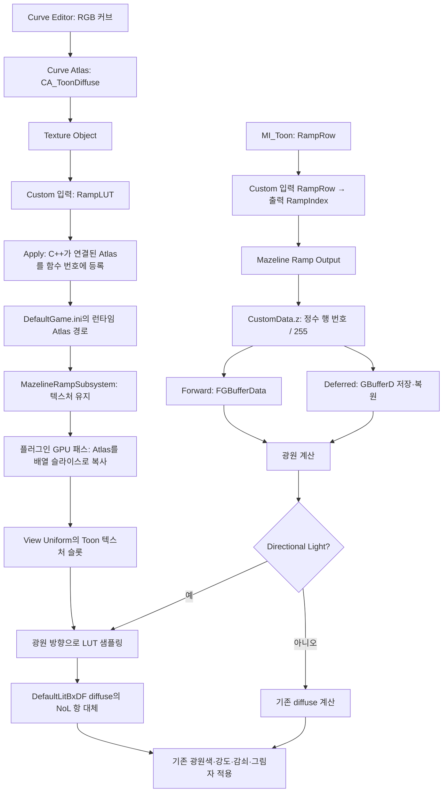

# Toon의 Directional Ramp LUT

Toon diffuse의 밝기·색 변화는 Unreal의 Curve Editor에서 작성한다. `M_Toon`은 Default Lit을 유지하며, 기존 Base Color·Metallic·Roughness·Specular·AO와 GGX의 Sharpness·Threshold 입력을 그대로 사용한다. HybridToon은 별도 예제에서 제거했다. 부드러운 변화와 계단형 변화 모두 Toon의 커브로 작성한다.

## 사용

1. `/Game/MazelineTests/Ramps/CA_ToonDiffuse`의 Gradient Curves 목록을 확인한다.
2. `CR_ToonLinear`, `CR_ToonSoft`, `CR_ToonSteps` 중 하나를 열고 RGB 커브를 편집한다. 가로축 0..1은 `saturate(N·L)`, 세로축은 해당 광원의 diffuse 응답이다. Alpha는 사용하지 않는다.
3. `MI_Toon`의 **Toon Diffuse → RampRow** 체크박스를 켜고 0=Linear, 1=Soft, 2=Steps를 선택한다. 기본값은 부모에서 상속한 2다. 소수는 정수로 반올림한다. 함수 번호 `MAZELINE_SHADER_OVERRIDE=2`와는 별개다.
4. 커브 키와 RampRow 변경은 패치 없이 반영한다. Atlas 에셋 자체를 교체하면 Custom의 `RampLUT` 입력을 변경하고 **Apply / Update Patch → 에디터 재시작**을 실행한다.

Constant 보간 키는 계단형, Linear/Cubic 키는 연속적인 응답을 만든다. LUT에는 bilinear 필터링을 적용하므로 계단 경계에도 약 한 texel 폭의 전이가 있다. 예제 Atlas 폭은 256이다.

## 데이터 전달

Custom 코드 예시는 `RampIndex = RampRow;`와 기존 Base Color 반환 코드다. **Custom에서 LUT를 미리 샘플링하지 않는다.** C++ 등록기가 `RampLUT`에 연결된 Texture Object의 Atlas를 찾아 런타임 바인딩을 구성한다. Deferred 광원 패스에서 머티리얼별 텍스처 포인터를 직접 전달할 수 없으므로 함수 하나당 Atlas 하나를 공유하고 행 번호를 픽셀별로 전달한다. 같은 함수 번호에 서로 다른 Atlas가 연결되면 적용을 거부한다. Texture Object Parameter의 인스턴스별 Atlas 교체는 지원하지 않는다.

## 셰이더 처리

`Toon.ush`의 `MAZELINE_DIRECTIONAL_RAMP=1`이 기능을 활성화한다. 기존 코드의 diffuse Band 곱셈은 제거한다.

- `ShadingModelsMaterial.ush`: RampRow를 정수 0..255로 제한해 CustomData.z에 저장한다. x/y는 기존 Sharpness/Threshold다.
- `DeferredLightingCommon.ush`: `!bRadialLight && !bRectLight`일 때만 광원 계산용 GBuffer 복사본의 CustomData.w를 1로 설정한다. 이 값은 MRT에 저장하지 않는다.
- `ShadingModels.ush`: 등록 함수와 위 플래그가 일치할 때만 Atlas를 샘플링한다. 행 중심을 읽어 이웃 커브가 섞이지 않게 하고, diffuse의 NoL 항을 RGB 램프로 대체한다. N·L을 다시 곱하지 않는다. GGX specular는 이 경로에서 수정하지 않는다.
- `MazelineRampSettings.cpp`: Scene View Extension이 입력 Atlas를 GPU 텍스처 배열에 복사하고 Base Pass 전에 View Uniform의 비어 있는 Toon 텍스처 슬롯에 바인딩한다. 슬라이스 0·1·2는 함수 번호 1·2·3이다. Texture Reference를 사용해 커브 편집에 따른 Atlas 리소스 갱신을 따라간다. 엔진 C++ 재빌드는 필요 없다.

이 바인딩은 **Substrate 비활성 상태**를 전제로 한다. Substrate가 활성화되면 View Extension은 해당 슬롯을 변경하지 않는다. 내장 Toon Profile 생성기나 Substrate Toon BSDF를 사용하는 방식은 아니다. Curve Atlas의 실제 텍스처를 복사하므로 커브와 Atlas의 색상 조정을 포함한 LUT 내용을 사용한다. 엔진 5.8.4의 `FViewInfo` 내부 헤더를 참조해 View Uniform을 교체하므로 다른 엔진 버전에서는 재검증이 필요하다. 이전에 제출된 Uniform Buffer를 수정하지 않고 새 버퍼를 만든다.

각 렌더 그래프에서 세 슬라이스를 만드는 작은 Compute Pass가 실행된다. 서로 다른 크기의 Atlas는 가장 큰 폭·행 수에 맞추며 작은 Atlas의 마지막 행을 반복한다. 등록되지 않은 슬롯은 선형 N·L 응답으로 채운다. VR·특수 Custom Render Pass와 쿠킹·패키징은 별도 검증 범위다.

Point·Spot·Rect의 diffuse, 환경 반사와 간접광에는 RampLUT을 적용하지 않는다. 광원 뒤쪽은 기존 DefaultLitBxDF의 NoL 조건을 유지하므로 램프의 0 위치가 밝더라도 뒷면을 밝히지 않는다. 베이크된 라이트맵에 램프를 적용하는 기능도 아니다. 임의 커브에 대한 물리적 에너지 보존을 보장하지 않는다.

Rect 조명 격리는 Deferred에서 검증한다. 이 설치의 Opaque Forward에서는 Rect 테스트가 실제 조명을 만들지 않아 지원·합격 범위에서 제외한다. 검은 이미지 두 장이 같다는 결과를 격리 성공으로 세지 않는다. [Epic의 Rect Light 문서](https://dev.epicgames.com/documentation/en-us/unreal-engine/rect-lights?application_version=4.27)에도 Forward 지원 제한이 설명되어 있으며, 현재 엔진의 `ForwardLightingCommon.ush`는 Rect 처리를 `SUPPORT_RECTLIGHT_ON_FORWARD_LIT_TRANSLUCENT` 조건으로 제한한다.

## 구현 위치와 복원

- `Shaders/Private/Toon.ush`: Toon 함수의 기능 선언과 GGX 분포 콜백.
- `Plugins/MazelineSuperOverriderMaterial/Source/MazelineMaterialRuntime/`: Ramp 출력 노드, 런타임 설정·리소스, Scene View Extension.
- `Plugins/MazelineSuperOverriderMaterial/Shaders/Private/MazelineRampAtlas.usf`: 입력 Curve Atlas를 GPU 배열의 함수별 슬라이스에 복사한다. Toon 셰이딩 함수가 아니므로 함수 번호 등록 개수와 무관하다.
- `Plugins/MazelineSuperOverriderMaterial/Source/MazelineSuperOverriderMaterial/Private/MazelineShaderPatchManager.cpp`: 그래프의 LUT 등록 검증, 다섯 엔진 셰이더의 생성·패치·복원.
- `Tools/configure_directional_ramp.py`: 예제 커브/Atlas 및 M_Toon 입력 연결.
- `Tools/validate_directional_ramp.py`: Forward·Deferred의 행 변경, 광원 종류별 격리, specular 유지, 실행 중 커브 편집 검증.

엔진 패치 관리 대상은 기존 네 파일에 `DeferredLightingCommon.ush`를 추가한 다섯 파일이다. 이전 원본 스냅샷은 수정하지 않고 `ramp-extension.json`이 추가 파일의 원본 스냅샷을 가리킨다. Restore는 다섯 파일을 원본으로 복원한다. 프로젝트 에셋의 변경 전 상태는 `Saved/DirectionalRamp/latest-backup.txt`에 기록된 폴더에 보관한다.

## 검증 (2026-11-03)

- VS 2022 / MSVC 14.44, Editor 및 Win64 Development 빌드 성공. `Saved/Logs/RampViewExtensionBuild.log`, `RampViewExtensionGameBuild.log`, 최종 테스트 광원 수정 빌드는 `RampLightHarnessBuild.log`, `RampLightHarnessGameBuild.log`에 기록했다.
- DX12/SM6, Opaque Default Lit, 이동식 직접광, `UnrealEditor -game`에서 유효 캡처 22개를 검증했다. Deferred 12개는 `Saved/DirectionalRamp/Validation-20261103-050810/verification.json`, Forward 10개는 `Saved/DirectionalRamp/forward-verification.json`에 원본 보고서 경로와 함께 기록했다.
- 방향광의 Linear / Soft / Steps 결과가 서로 다르고, 실행 중 커브 RGB 키를 수정하면 재패치 없이 결과가 바뀐다. Point·Spot 및 Deferred Rect는 행 0과 2의 이미지가 픽셀 단위로 같으며, 실제 조명이 있는 이미지임을 함께 확인했다. 방향광 specular-only 이미지도 행 변경 전후가 같다. 테스트 중 에셋·프로젝트 셰이더·엔진 셰이더 해시는 유지됐다.
- 네이티브 자동 테스트 10개 성공, 실패·경고 0: `Saved/Automation/DirectionalRampFinal/index.json`. 실제 엔진 5파일 Restore → 원본 해시 일치 → Apply → 기존 적용본 해시 일치를 확인했다. 원본 스냅샷은 변경하지 않았고 최종 상태는 applied/matches=yes다. `Saved/DirectionalRamp/restore-verification.json`.
- 저장된 M_Toon은 Default Lit, MI_Toon은 Roughness=0.5 / Sharpness=0.5 / Threshold=0.25 / RampRow=2다. `Saved/DirectionalRamp/asset-verification.json`.
- Ramp 추가 후 GGX 회귀 8개 캡처도 통과했다. 두 경로에서 Sharpness 0 / 0.5 / 1과 Threshold 변경 결과가 각각 다르며 셰이더·패치 해시는 유지됐다. `Saved/GGXParameters/Validation-20261103-051045/verification.json`.

개발 중 발견한 두 문제도 수정했다. Custom의 BaseColor·RampIndex 소비 경로에서 include가 중복되어 Forward 함수 선언이 충돌하던 문제는 Toon.ush의 include guard로 해결했다. Deferred 등록본은 콜백 이름을 매크로로 바꿔 별도 생성되므로 해당 경로는 guard를 우회한다. Spot 검증 광원은 Spawn의 기본 회전이 합성되어 구체를 비추지 않았고, 생성 후 월드 회전을 명시해 다시 검증했다. 초기 실패 보고서는 덮어쓰지 않고 보관했다. Opaque Forward Rect의 검은 캡처는 성공으로 계산하지 않았다.

Curve Editor 화면 확인에서 예제 생성 시 기본 키가 중복된 문제도 발견했다. UCurveLinearColor 생성자의 0·1 키를 Reset한 뒤 예제 키를 추가하도록 수정했다. 최초 예제 에셋은 중복 패턴을 확인한 뒤 생성자 키만 제거했으며, Steps의 0.1 / 0.5 / 0.9 샘플이 각각 0.12 / 0.5 / 1인지 수치로 검증했다. 수정 전 에셋은 `Saved/DirectionalRamp/CurveKeysBeforeRepair`, 결과는 `curve-repair.json`에 보관했다. 수정 후 두 경로의 방향광 12개 사례(행 3종·specular 격리·실시간 편집)를 다시 검증했다: `Saved/DirectionalRamp/Validation-20261103-051648/verification.json`. 이 보고서가 방향광 검증의 최신본이며, 로컬 광원 격리 결과는 위 보고서를 유지한다. 최종 에디터 빌드는 `Saved/Logs/RampCurveFactoryBuild.log`다.

쿠킹·패키징, VR, Nanite, Substrate는 이번 합격 범위에 포함하지 않는다.

노드 썸네일은 엔진에서 Unlit 머티리얼로 컴파일된다. GGX/Ramp 출력 요구 조건을 `MATERIAL_SHADINGMODEL_DEFAULT_LIT` 안으로 한정해, Custom 노드 썸네일에 존재하지 않는 Custom Output을 요구하던 오류를 수정했다. 최종 네이티브 테스트 10개는 `Saved/Automation/RampNodePreviewFinal/index.json`, 최종 빌드는 `Saved/Logs/RampNodePreviewBuild.log`다. 복원·재적용을 다시 확인했고, 두 경로의 Default Lit 캡처가 수정 전 결과와 픽셀 단위로 동일함을 검증했다: `Saved/DirectionalRamp/preview-fix-verification.json`.
