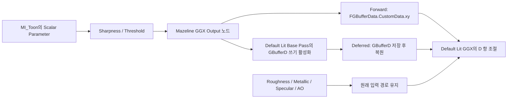

# Stylized / Toon 구성

현재 활성 예제는 Stylized와 Toon 두 개다. HybridToon은 Toon으로 통합했다. Example 맵의 기존 HybridToon 슬롯은 MI_Toon으로 교체하고 액터 이름은 Mazeline Toon Alternate로 변경했다. 위치·광원·카메라는 유지했다. 삭제 전 에셋과 셰이더는 `Saved/HybridRetirement/latest-backup.txt`에 기록된 폴더에 보관한다.

| 이전 에셋 | 현재 에셋 | Define 값 | Include File Paths |
| --- | --- | --- | --- |
| M_ForwardControl | /Game/MazelineTests/M_Stylized | 1 | /Project/Private/Stylized.ush |
| M_ForwardOverride | /Game/MazelineTests/M_Toon | 2 | /Project/Private/Toon.ush |

Define 이름은 모두 `MAZELINE_SHADER_OVERRIDE`다. 파일은 프로젝트의 `Shaders/Private`에 있으며 함수 이름은 모두 `MazelineEvaluateShaderOverride`다.

함수 번호 3은 현재 미등록 상태다. 플러그인의 1·2·3 등록 기능은 유지하므로 향후 별도 사용자 함수를 등록할 수 있다. 번호는 파일 개수가 아니며 기존 GBuffer의 2비트 인코딩도 그대로 유지한다.

## 그래프

- Stylized: 기존 색상 Constant → Tint 입력을 가진 Custom → Base Color. Custom Code는 `return Tint;`다.
- Toon: 기존 Custom의 색상 반환 코드를 보존하고 2번 / Toon.ush로 연결했다.
- 두 머티리얼은 Metallic·Roughness Scalar Parameter를 사용한다. 초기 기본값은 각각 0과 0.5다.
- Custom의 Description에 번호와 스타일을 표시했다. Toon 인스턴스에서 Roughness·Sharpness·Threshold를 조절한다.

## 예제 HLSL의 차이

- Stylized: 광원 방향에 따라 부드럽게 변화하는 diffuse와 어두운 구간의 푸른 색조. Roughness 입력을 유지한다.
- Toon: Curve Atlas로 Directional Light diffuse를 제어하고 GGX 직접광 스페큘러의 선명도를 별도로 조절한다. MI_Toon의 RampRow는 Linear(0) / Soft(1) / Steps(2)를 고른다. Steps 예제 커브의 초기 경계는 0.25 / 0.65이며 코드 상수가 아니다. Point·Spot·Rect diffuse에는 램프를 적용하지 않는다. [데이터 전달과 사용법](Directional-Ramp.md)을 참조한다.

두 함수는 스타일 출발점인 예제다. 최종 화면색을 직접 출력하지 않으며 광원 감쇠·그림자는 계속 적용된다. Stylized는 기존 Default Lit specular를 사용하고, Toon은 아래의 GGX 분포 콜백으로 D 항을 조절한다. HLSL 변경 후 Project Settings → Plugins → Mazeline Super Override Material → Apply / Update Patch를 실행하고 재시작한다.

## 기존 회귀 검증 자료

원본 Content/MazelineTests와 Shaders/Private, 함수 등록 JSON을 `Saved/StyleMigration/20261102-015858`에 보관했다. 당시 기존 세 ush는 해당 백업의 `RetiredShaderFiles`로 이동했다. 이후 HybridToon을 제거해 현재 활성 Shaders/Private에는 Stylized.ush와 Toon.ush만 남아 있다.

별도 InputValidation의 M_Override와 M_RoughnessOverride는 이전 함수 3/2를 사용하므로, 새 스타일 등록과 충돌하지 않게 MAZELINE_SHADER_OVERRIDE와 include를 해제했다. 에셋과 재질 입력은 남아 있지만 **현재는 과거 오버라이드 회귀 테스트를 실행하는 구성은 아니다.** 기존 GPU 검증 보고서는 당시 소스에 대한 역사적 결과다. 회귀 캡처 스크립트는 이전 등록이 비활성인 경우 명시적으로 중단한다.

복구하려면 에디터를 종료하고 백업된 에셋·셰이더와 그 등록 구성을 복원한 다음 C++ 관리자로 다시 Apply한다. 엔진 원본을 복원하는 Restore 버튼만으로 프로젝트 머티리얼의 이름과 그래프가 돌아가지는 않는다. 엔진 최초 원본 백업은 별도로 Engine/Saved/MazelineShaderOverride에 계속 보존한다.

## 확인 자료

- `Saved/StyleMigration/migration-result.json`: 이름 변경, 함수 번호와 include, 비교 맵 연결.
- `Saved/StyleMigration/verification.json`: 저장 후 다시 로드해 Custom 연결, 세 입력 핀, 기존 Multiply 보존, 세 구의 재질 할당을 확인한 결과.
- `Saved/Mazeline/deferred_registry.json`: 현재 C++ 관리자가 수집한 1=Stylized / 2=Toon. HybridToon 삭제 후 3번 등록을 제거했다.
- `Saved/HybridRetirement/retirement.json`: 기존 슬롯 교체, 잔여 참조 없음, 에셋 삭제 기록.
- `Saved/Logs/StylePatchApply.log`: Python을 비활성화한 C++ 커맨드릿의 엔진 패치 성공 기록.

머티리얼 에셋 변경에는 프로젝트의 UE Python 에디터 API를 사용했다. 엔진 패치는 기존대로 플러그인 내부 C++이 수행했다.

## 과거 세 함수 구성의 렌더링 확인

DX11/SM5의 Deferred와 Forward에서 비교 맵을 각각 실행하고 GPU 캡처를 확인했다. 두 로그에 셰이더 컴파일 오류가 없고, 세 구의 부드러운 변화 / Toon 단계 / 혼합 결과를 확인했다. 이번 캡처는 UnrealEditor의 `-game` 실행이며 새 게임 패키징 결과는 아니다.

- `Saved/StyleMigration/Deferred.png`, `Saved/Logs/StyleRenderDeferred.log` (`r.ForwardShading=0`).
- `Saved/StyleMigration/Forward.png`, `Saved/Logs/StyleRenderForward.log` (`r.ForwardShading=1`).
- `Saved/Logs/StylePatchStatus.log`: `state=applied matches=yes`.

위 캡처 당시에는 검증 실행에 DX11/SM5와 Forward 임시 옵션을 지정했다.

## 현재 Windows 실행 설정: DX12 / SM6

사용자 요청에 따라 Windows 기본 RHI는 `DefaultGraphicsRHI_DX12`, D3D12 타깃은 `PCD3D_SM6`로 사용한다. D3D11의 `PCD3D_SM5` 타깃은 해제했다. 에디터는 `-d3d11 -sm5` 없이 프로젝트 기본 설정으로 재시작했다. Visual Studio 2022와 기존 Ray Tracing 등 다른 렌더링 설정은 유지한다.

실행 로그 `Saved/Logs/StyleEditorDX12.log`에서 `rhiname="D3D12"`, `shaderplatform="PCD3D_SM6"`를 확인했다. 앞의 DX11/SM5 캡처와 패키징 기록은 해당 환경에서 수행한 과거 검증이며 DX12 패키징 검증을 뜻하지 않는다.

SM6 셰이더 컴파일과 에디터 초기화가 끝난 뒤 비교 맵의 세 스타일이 표시되는 것을 확인했다. 해당 시작 로그에 셰이더 컴파일 오류는 없다. 이번 확인은 기본 Deferred 에디터 실행이며 DX12 Forward나 패키징의 추가 검증은 포함하지 않는다.

## 이전 Toon 하이라이트 확장 이력

첫 구현은 `Toon.ush`의 `MazelineEvaluateSpecularOverride()`에서 N·H 내적을 `step()`으로 잘라 직접광 specular를 교체했다. 아래 로그·캡처는 이 초기 방식의 이력이다. 현재 GGX 분포 개선은 다음 절을 참조한다.

초기 구현에서는 Roughness Scalar Parameter를 `Toon Highlight` 그룹의 크기 조절값으로 사용했다. 기본값은 0.5였으며, 작을수록 작은 하이라이트, 클수록 넓은 하이라이트였다. 색상 텍스처·Multiply와 다른 핀 연결은 보존했다. 당시 밝기 상수 `HighlightStrength`는 현재 GGX 구현에서 제거했다.

초기 확장은 직접광 스페큘러만 교체했다. 환경 반사·간접광까지 경계를 자르지는 않았으며, 면광원의 LTC 적분·광원 텍스처를 재현하지 않았다. 콜백이 없는 스타일은 기존 스페큘러를 유지했다. 현재 함수 계약은 플러그인 README의 “GGX 분포의 선명도 조절”을 참조한다.

- `Saved/ToonHighlight/latest-backup.txt`: 변경 직전 사용자 M_Toon과 Toon.ush의 백업 위치.
- `Saved/ToonHighlight/material.json`: 텍스처·Multiply·파라미터 기본값 보존 확인.
- `Saved/Logs/ToonHighlightBuild.log`: VS 2022 빌드 성공.
- `Saved/Logs/ToonHighlightApply.log`: 네이티브 패치 적용 성공.
- `Saved/Automation/ToonHighlightNative/index.json`: 선택적 콜백 계약 오류·복원을 포함한 자동 테스트 6개 통과.
- `Saved/ToonHighlight/Deferred.png`, `Forward.png`: 사용자 Example 맵의 DX12/SM6 실제 렌더링 캡처. 두 경로 모두 Toon 구의 선명한 하이라이트와 기존 텍스처를 확인했다. 기존 비교 카메라를 사용해 라벨의 뒷면이 보이며 카메라·맵은 변경하지 않았다.
- `Saved/Logs/ToonHighlightDeferred.log`, `ToonHighlightForward.log`: D3D12 / PCD3D_SM6, Forward 설정 0/1, 셰이더 컴파일 오류 없이 캡처 완료. UnrealEditor `-game` 검증이며 패키징 검증은 아니다.
- `Saved/Logs/ToonHighlightStatus.log`: 최종 엔진 상태 `applied matches=yes`.

## 이전 GGX 분포 개선 이력 — HLSL 상수 버전

이 절은 인스턴스 파라미터를 추가하기 전의 기록이다. 현재 사용법은 아래 “머티리얼 인스턴스 파라미터” 절을 따른다.

현재 `Toon.ush`는 `MAZELINE_HAS_GGX_DISTRIBUTION_OVERRIDE=1`과 `MazelineEvaluateGGXDistribution(D, PeakD)`를 사용한다. C++ 생성기는 설치된 엔진의 `SpecularGGX()`를 바탕으로 D 항만 바꾸는 변형을 만들며, 원래 Fresnel·가시성·광원 크기 보정은 유지한다. 일반 머티리얼, 콜백 없는 스타일, Rect Light와 이방성 경로는 원래 함수를 사용한다.

Roughness는 기존 GGX 폭·피크를 조절한다. `Toon.ush`의 `Sharpness=0.5`, `Threshold=0.25`가 선명도와 상대 경계를 조절한다. Sharpness가 0이면 원래 분포를 그대로 반환하고, 중간값은 단일 GGX 분포의 대조도를 높이며, 1이면 단계 경계가 된다. 두 결과를 섞는 방식이 아니며 별도 밝기 8배 보정도 제거했다. 두 HLSL 상수는 현재 함수별 설정이므로 인스턴스별 파라미터로 노출되어 있지는 않다.

HLSL을 저장한 뒤 Apply / Update Patch와 재시작으로 갱신한다. 기존 색상 텍스처·Multiply·Roughness 입력 연결은 유지한다. 환경 반사와 간접광은 원래 경로를 사용한다. 변형된 분포의 물리적 에너지 보존을 보장하는 기능은 아니다.

### GGX 개선 검증 (2026-11-02)

- `Saved/Logs/GGXHighlightBuild.log`: VS 2022 / MSVC 14.44.35228 빌드 성공.
- `Saved/Automation/GGXHighlightNative/index.json`: 자동 테스트 7개 성공, 경고·실패 0. 콜백 계약·중복 모드 거부·엔진 삽입 지점 변경 거부·원본 복원·기존 백업 호환을 포함한다.
- `Saved/GGXHighlight/material.json`: M_Toon 노드 5개, Roughness 기본값 0.5, 기존 텍스처와 핀 연결 보존 확인.
- `Saved/GGXHighlight/Validation-20261102-171244/verification.json`: 고정 조명 장면에서 원본 GGX와 Sharpness 0의 RGB 픽셀이 완전히 일치한다. Sharpness 0.5와 1은 각각 다른 결과를 만든다. 같은 폴더의 Baseline / Sharpness0 / Sharpness05 / Sharpness1 PNG를 비교할 수 있다.
- 같은 폴더의 `Sharpness05Forward.png`와 로그: DX12/SM6 Forward 실행 성공. 위 다섯 실행에서 셰이더 컴파일 오류 없이 캡처를 완료했다. UnrealEditor `-game` 검증이며 패키징 검증은 아니다.
- `Saved/Logs/GGXHighlightStatus.log`: 최종 `applied matches=yes`.

검증 맵은 `/Game/MazelineTests/GGXValidation/L_GGXValidation`이다. `Tools/create_ggx_validation_scene.py`로 별도 생성했으며 사용자 Example 맵은 수정하지 않는다. `Tools/validate_ggx_highlight.py`는 에디터를 닫은 상태에서 임시 셰이더 변형을 적용·캡처하고, 성공 여부와 관계없이 마지막에 작성자의 셰이더와 패치를 복원한다. 비교 실행에만 고정 타임스텝과 간접광·반사·블룸 비활성 옵션을 사용하며 프로젝트 설정은 바꾸지 않는다.

초기 비교 실행(`Validation-20261102-170336`)은 배경·프레임 조건이 달라 픽셀 일치 검증에 실패했고, 원본 GGX 실행 중 MegaLights 플랫폼 컴파일러 오류도 기록됐다. 해당 실행은 합격 근거에서 제외했다. 고정 장면 재검증에서는 오류가 재현되지 않았다.

## 머티리얼 인스턴스 파라미터 (현재)

`/Game/MazelineTests/MI_Toon`의 **Toon Highlight** 그룹에서 Roughness(0.5), Sharpness(0.5), Threshold(0.25)를 조절한다. Example 맵의 `Mazeline Toon` 구에 이 인스턴스를 할당했다. 파라미터 값 변경은 엔진 패치나 재시작 없이 반영된다. M_Toon의 기존 텍스처·Multiply·Base Color·Metallic·Roughness·Specular·AO 입력은 보존했다.

M_Toon의 Shading Model은 **Default Lit**이다. **Mazeline GGX Output** 노드를 하나 추가하고 Sharpness·Threshold Scalar Parameter를 이름이 같은 입력에 연결한다. 두 값은 CustomData.x/y로 전달하며 기존 재질 입력을 유지한다. `Toon.ush`의 `MAZELINE_GGX_MATERIAL_PARAMETERS=1`이 이 계약을 선언하고, 4인자 `MazelineEvaluateGGXDistribution(D, PeakD, Sharpness, Threshold)`가 전달된 값을 읽는다. 기존 두 인자 콜백은 별도로 지원한다.

Deferred는 기존 CustomData MRT를 사용하며 Specular·AO 채널을 소비하지 않는다. 기본 GBuffer에서 각 컨트롤은 8비트 UNORM이므로 Forward와 양자화 차이가 있다. 환경 반사·간접광은 기존 경로이며, Rect Light LTC·이방성 specular의 분포는 이 콜백으로 바꾸지 않는다. 엔진 패치를 복원해도 Shading Model을 바꿀 필요 없이 일반 Default Lit로 렌더링된다. Deferred 내부의 함수 구분용 ID 14는 그대로 사용하며 에디터의 Shading Model 선택과는 별개다. 현재 전용 노드는 기존 HLSL Material Translator 경로를 사용한다. 새 MIR 생성기는 지원 범위에 포함하지 않는다.

### 이전 Clear Coat 전달 방식 검증 자료

- `Saved/Logs/GGXParametersBuild.log`: VS 2022 빌드 성공.
- `Saved/Automation/GGXParametersNativeFinal/index.json`: 자동 테스트 8개 성공, 경고·실패 0. 기존 백업의 확장·중단 복구·네 파일 복원·외부 수정 거부를 포함한다.
- `Saved/GGXParameters/material.json`, `instance-assignment.json`: 입력 연결과 기본값 보존, MI_Toon 생성, Example의 Toon 슬롯 할당.
- `Saved/GGXParameters/Validation-20261102-174021/verification.json`: DX12/SM6 Forward·Deferred 각각에서 동적 인스턴스의 Sharpness 0/0.5/1 및 Threshold 0.25/0.6을 변경한 8회 GPU 캡처. 셰이더/패치 해시는 그대로이며 각 비교 이미지가 다르다. 해당 로그에 셰이더 컴파일 오류는 없다. 고정 직접광 장면의 UnrealEditor `-game` 검증이며 패키징 결과가 아니다.
- `Saved/Logs/GGXParametersRestore.log`, `GGXParametersReapply.log`, `GGXParametersStatus.log`: 설치된 엔진의 네 원본 파일 해시 복원 확인 후 재적용, 최종 `applied matches=yes`.

초기 시도의 이미지가 동일한 문제를 검출한 뒤 include 순서에 의존하던 분기를 등록 ID로 바꾸고, UE 5.8 CustomData 핀의 `UseConstant`를 해제해 연결된 표현식이 평가되도록 수정했다. 위 폴더는 당시 Clear Coat 전달 방식의 합격 근거다. 재검증은 에디터를 닫고 `Tools/validate_ggx_parameters.py`로 수행하며, 이전 `validate_ggx_highlight.py`는 상수 방식의 역사적 도구다.

### Default Lit 전환 검증

- `Saved/Automation/DefaultLitGGXFinal/index.json`: 최종 런타임 모듈 구성에서 자동 테스트 9개 성공, 경고·실패 0. Default Lit 전환, Specular·AO 연결 보존, 반복 전환 시 노드 중복 방지, 충돌 거부와 기존 패치 수명주기를 포함한다.
- `Saved/Logs/DefaultLitGGXBuild.log`, `DefaultLitGGXGameBuild.log`: VS 2022 Editor 및 Win64 Development 게임 타깃 빌드 성공. 출력 노드를 Runtime 모듈로 분리하고 패치·설정 UI는 Editor 모듈에 유지했다. 게임 타깃 빌드는 쿠킹·패키징 완료를 뜻하지 않는다.
- `Saved/DefaultLitGGX/material.json`: M_Toon의 Default Lit 선택, 기존 입력 연결과 파라미터 기본값 보존.
- `Saved/GGXParameters/Validation-20261102-195044/verification.json`: Default Lit 상태에서 Forward·Deferred 각각 Sharpness 0/0.5/1과 Threshold 변경을 검증한 8개 캡처. 셰이더 오류 없이 파라미터별 결과가 달라지며 테스트 동안 패치/HLSL 해시는 변하지 않았다.
- `Saved/DefaultLitGGX/carrier-comparison.json`: 위 8개 캡처가 이전 Clear Coat 전달 방식의 `Validation-20261102-174021` 결과와 모두 픽셀 단위로 일치한다.
- `Saved/GGXParameters/Validation-20261102-195250/verification.json`: `r.VelocityOutputPass=1`인 Deferred에서도 4개 파라미터 사례 통과. 생성된 GBuffer 코드에서 Velocity는 MRT4, CustomData는 MRT5에 배치되는 것을 확인했다. 기본 구성의 MRT4와 Velocity 구성의 MRT5 출력을 각각 검증했다.

이전 시도 `Validation-20261102-194734`는 출력 노드가 Editor 모듈에 있어 `-game`에서 로드되지 않은 실패 기록이다. Runtime 모듈로 이동하고 머티리얼을 재저장한 뒤 재검증했다. 이 실패 폴더는 합격 근거에서 제외한다.
